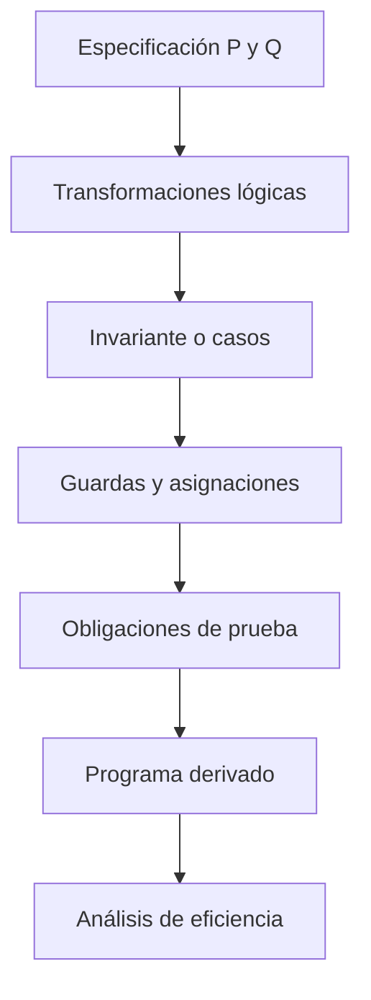

# 0 — Introducción

> **Capítulo 0: Introducción.** Competencias globales del capítulo:
> - Distinguir programa, especificación y demostración.
> - Especificar un problema con predicados de estado.

## Competencias de esta sección

- **Conocimiento:** definir con precisión los términos y expresiones de «introducción».
- **Desempeño:** aplicar el cálculo de predicados y las transformaciones justificadas en un problema concreto.
- **Evidencia:** entregar una especificación o derivación anotada, con hipótesis explícitas y límites de validez.

> **Referencia:** Kaldewaij, cap. 0, sección 0, página impresa 1. [Ver página original](../recursos/libro-original-escaneado.pdf#page=15).

## Desarrollo


### 1. La actividad de programar

Una descripción operacional del tipo «leer dos números, compararlos y escribir uno» no explica por qué el programa es correcto. La formulación extensional dice qué relación debe existir entre el estado inicial y el final. Un **estado** asigna valores a las variables: si `x,y` son enteros, el espacio de estados inicial puede ser `ℤ × ℤ`. Un **predicado** es una propiedad de estados.

Para el máximo de dos enteros constantes `A,B`, una especificación es:

```text
|[ con A,B : int;
   var m : int;
   {true}
   S
   {m = A max B}
]|
```

La corrección no exige una secuencia operacional concreta: múltiples programas pueden satisfacerla. El cometido de la derivación es elegir instrucciones justificadas mediante relaciones lógicas.

### 2. Primer desarrollo, con guardas

Usaremos una propiedad algebraica de `max`:

$$m=A\max B \equiv (A\ge B\land m=A)\lor(B\ge A\land m=B).$$

La equivalencia sugiere dos casos: `A ≥ B` y `B ≥ A`. En igualdad ambos casos son verdaderos, y ambos valores son idénticos.

```text
if A ≥ B → m := A
[] B ≥ A → m := B
fi
```

**Por qué el paso es válido:** si se elige la primera rama, `A ≥ B` permite concluir `A max B = A`; la asignación establece `m=A`. La otra rama es simétrica. Alguna guarda es verdadera para todos los enteros `A,B`. No hemos usado una ejecución particular como argumento de corrección.

### 3. Tres obligaciones diferentes

- **Inicialización/cobertura:** el programa debe poder comenzar desde toda entrada que satisface `P`.
- **Corrección:** si termina, debe alcanzar `Q`; además, en la disciplina de corrección total, necesitamos **terminación**.
- **Eficiencia:** una vez satisfecha `Q`, podemos seleccionar transformaciones cuyo costo sea adecuado. Eficiencia no sustituye corrección.

### 4. Método que emplearemos



Esta secuencia es una guía pedagógica; la derivación real puede ser exploratoria y requerir fortalecer o reformular un invariante.

### 5. Ejercicios de competencia

1. Especifica la mínima de tres constantes enteras sin escoger aún un algoritmo.
2. Justifica formalmente por qué `if x≤y → z:=x [] y≤x → z:=y fi` satisface `z=x min y`.
3. Da un ejemplo donde el test de un único dato es correcto pero el programa es incorrecto para otra entrada.
4. Explica por qué la afirmación «se ejecutó exitosamente» no constituye una prueba universal.

**Criterio de evaluación:** respuesta con predicados explícitos, cobertura de guardas y justificación de todas las ramas.

### Para continuar

La herramienta fundamental no será la intuición sobre instrucciones, sino un cálculo algebraico preciso sobre predicados; es el objeto del capítulo 01.

## Comprobación de competencia

1. Formula la propiedad central como un predicado explícito, indicando el dominio y las condiciones de definibilidad.
2. Justifica una transformación algebraica relevante sin usar solo ejemplos concretos como prueba.
3. Construye un caso límite que pueda refutar una hipótesis insuficiente.
4. Declara qué parte está demostrada y cuál constituye solamente evidencia experimental.


---

**Navegación:** [Índice del curso](../README.md)
