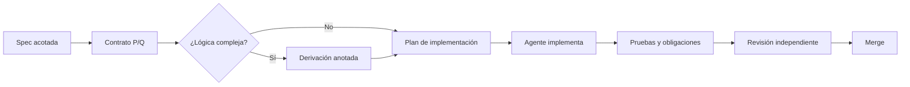

# 14.4 — Ciclo de implementación derivada

## Competencias de esta sección

- **Conocimiento:** definir con precisión los términos y expresiones de «ciclo de implementación derivada».
- **Desempeño:** aplicar el cálculo de predicados y las transformaciones justificadas en un problema concreto.
- **Evidencia:** entregar una especificación o derivación anotada, con hipótesis explícitas y límites de validez.

> **Material complementario original:** aplicación actual de los métodos de Kaldewaij; no corresponde a una sección del libro de 1990.

## Desarrollo

### Regla de alcance

Si la derivación encuentra una necesidad nueva (por ejemplo, estado auxiliar, restricción de entradas, precondición del proveedor), se **actualiza la spec antes de introducir el cambio**. No se aprovecha el agente para alterar silenciosamente el contrato funcional.

### Trabajo con el método formal

Escribe un predicado de entrada `P` y otro de salida `Q`. Elige una operación simple `S` y calcula la condición que la hace segura. Cada equivalencia `≡` debe indicar la ley usada; cada implicación `⇒` debe explicitar la dirección del razonamiento. Si hay un ciclo, identifica el invariante y una función acotada que decrece. Cuando el algoritmo invoca componentes externos, separar el contrato del componente de su implementación efectiva.

## Comprobación de competencia

1. Formula la propiedad central como un predicado explícito, indicando el dominio y las condiciones de definibilidad.
2. Justifica una transformación algebraica relevante sin usar solo ejemplos concretos como prueba.
3. Construye un caso límite que pueda refutar una hipótesis insuficiente.
4. Declara qué parte está demostrada y cuál constituye solamente evidencia experimental.

---

**Navegación:** [← 14.3 - División de features y dependencias](<14.3 - División de features y dependencias.md>) · [Índice del curso](../README.md)
