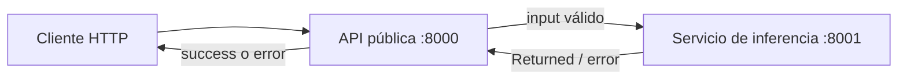

# 18.0 — Caso de uso y arquitectura

> **Capítulo 18: Laboratorio de API de inferencia de ML.** Competencias globales del capítulo:
> - Construir una API de inferencia derivada.
> - Ejecutar y comprobar código Python real.

## Competencias de esta sección

- **Conocimiento:** definir con precisión los términos y expresiones de «caso de uso y arquitectura».
- **Desempeño:** aplicar el cálculo de predicados y las transformaciones justificadas en un problema concreto.
- **Evidencia:** entregar una especificación o derivación anotada, con hipótesis explícitas y límites de validez.

> **Material complementario original:** aplicación actual de los métodos de Kaldewaij; no corresponde a una sección del libro de 1990.

## Desarrollo

Una aplicación empresarial necesita exponer `POST /predict` para clientes. El usuario envía edad, ingresos y antigüedad de relación; la API pública valida la petición e invoca a un proceso de inferencia. En éxito devuelve probabilidad de abandono y versión del modelo. Ante entrada inválida, **no invoca** el modelo; ante fallo externo o respuesta incompatible, devuelve un error controlado.

La API del modelo en este laboratorio utiliza una **fórmula determinística de demostración** para evitar requerir artefactos de entrenamiento. **No representa un modelo entrenado ni constituye una estimación estadística validada.** En producción se reemplaza solo esa parte respetando el contrato de respuesta.

### Requisitos

- Entrada JSON con `age` entero de 0 a 120, `income` numérico finito de 0 a 1 000 000, `tenure` entero de 0 a 600.
- En éxito, `prediction` numérica finita en `[0,1]`, `model_version` cadena no vacía.
- No realizar llamadas upstream con entrada inválida.
- Una sola invocación upstream por request válido (sin retries implícitos de aplicación).
- Diferenciar entrada inválida (`422`), timeout (`504`) y falla/respuesta inválida del upstream (`502`).
- Sujeto al contrato de bibliotecas y entorno, el endpoint devuelve respuesta controlada; no se garantiza un deadline absoluto de proceso.

## Comprobación de competencia

1. Formula la propiedad central como un predicado explícito, indicando el dominio y las condiciones de definibilidad.
2. Justifica una transformación algebraica relevante sin usar solo ejemplos concretos como prueba.
3. Construye un caso límite que pueda refutar una hipótesis insuficiente.
4. Declara qué parte está demostrada y cuál constituye solamente evidencia experimental.

---

**Navegación:** [Índice del curso](../README.md) · [→ 18.1 - Especificación formal del endpoint](<18.1 - Especificación formal del endpoint.md>)
