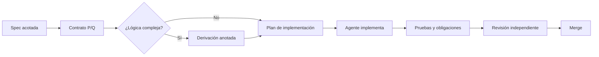

# 14 · Specification-Driven Development por feature con derivación proporcional

**Módulo complementario.** **Carga:** 4 h. El método de Kaldewaij sirve para fundamentar el núcleo lógico; SDD y archivos del repositorio son decisiones contemporáneas de proceso.

## Competencias a lograr

1. Dividir una aplicación en specs pequeñas que representen capacidades funcionales independientes con contratos verificables.
2. Decidir **cuánta formalidad** necesita cada spec según riesgo, complejidad algorítmica y posibilidad de falla.
3. Mantener trazabilidad `requisito → Q → derivación → código → evidencia` sin duplicar documentación innecesariamente.

**Evidencias:** backlog de cuatro specs autocontenidas y derivación de una de ellas; registro de dependencias de alcance y aceptación.

## 1. Una spec no debería describir toda la aplicación

Un ejemplo de sistema de consultorio:

- SPEC-001: registrar paciente.
- SPEC-002: consultar historial.
- SPEC-003: registrar consulta.
- SPEC-004: generar resumen de riesgo con un modelo ML.

Cada spec incluye su propia finalidad, datos, contratos, pruebas, límites y dependencias explícitas. No asumimos que independiencia significa ausencia de dependencias técnicas: significa que la **unidad de aceptación** es aislable y verificable.

## 2. Estructura de spec mínima recomendada

```text
specs/
  004-ml-risk/
    spec.md          # qué debe cumplirse
    plan.md          # diseño mínimo y dependencias
    tasks.md         # trabajo atomizado y verificaciones
    derivation.md    # opcional, cuando corresponda
```

El archivo `derivation.md` **no es obligatorio** para cada CRUD. En lógica crítica o algorítmica, sí debería justificarse la elección de invariante/guardas y las obligaciones de corrección. El contenido de `spec.md` debe evitar códigos prematuros que prejuzguen la derivación.

## 3. Niveles de formalización

| Nivel | Uso típico | Exigencia |
|---|---|---|
| A — Contrato | UI, CRUD rutinario | `P`, `Q`, casos, datos inválidos y pruebas |
| B — Derivación breve | Validación compleja, API ML, reglas | A + selección, equivalencias, condiciones de procedencia |
| C — Derivación completa | Algoritmos, cálculos críticos, performance | B + invariant theorem, terminación, análisis de complejidad |

Los niveles son una **política propuesta del curso** y no categorías de Kaldewaij. Cada proyecto debe ajustar el umbral a su riesgo real.

## 4. De una feature a la siguiente

Las relaciones entre specs se resuelven mediante contratos. Por ejemplo, SPEC-004 puede depender de un contrato de lectura de paciente, pero **no copiar** la implementación de SPEC-002. Las obligaciones de suponer/probar deben explicitar: `precondición que espera el consumidor`, `postcondición que promete el proveedor`.

Una dependencia está bien planteada si:

$$Q_{proveedor}\Rightarrow P_{consumidor}.$$

Si esta implicación no es válida, faltan conversiones, validaciones o una renegociación del contrato.

## 5. Proceso propuesto



### Regla de alcance

Si la derivación encuentra una necesidad nueva (por ejemplo, estado auxiliar, restricción de entradas, precondición del proveedor), se **actualiza la spec antes de introducir el cambio**. No se aprovecha el agente para alterar silenciosamente el contrato funcional.

## 6. Ejercicio

Diseña cuatro specs de una API de inferencia ML (validación, transporte HTTP, contrato del modelo, observabilidad). Marca dependencias y decide cuáles necesitan `derivation.md` y por qué. Demuestra al menos una implicación entre contrato proveedor y consumidor.

**Criterio:** cada spec debe ser breve y evaluable por sí misma; el diseño de arquitectura no debe depender de una super-spec monolítica.
